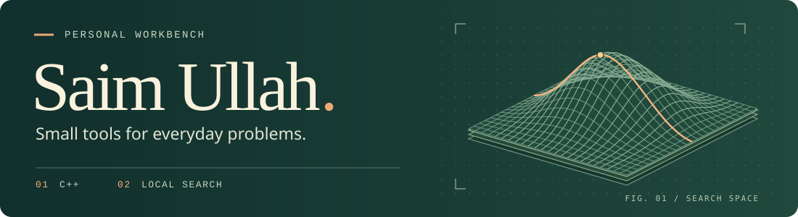

# Hi, I'm Saim Ullah 👋

**Computer Science · Agentic AI · Automation · MERN Stack**

I build practical tools that turn ideas into useful workflows—from task-oriented agents and automation scripts to full-stack web applications. I enjoy learning by building, testing, and refining projects.

### 🧠 Agentic AI
**[Research Agent](https://github.com/Saim-Ullah/research-agent)** — a local, tool-using research assistant that searches a supplied knowledge base, plans steps and produces source-linked answers. No API key required.

### ⚙️ Automation
**[Workflow Automation](https://github.com/Saim-Ullah/workflow-automation)** — validate and summarize recurring CSV data with clear error reports and repeatable command-line runs.

### 🌐 MERN Stack
**[MERN Taskboard](https://github.com/Saim-Ullah/mern-taskboard)** — a full-stack task manager built with MongoDB, Express, React and Node.js.

### 🛠️ Toolkit
`JavaScript` · `React` · `Node.js` · `Express` · `MongoDB` · `Python` · `Git` · `C++`

> Building thoughtfully, one useful project at a time.
